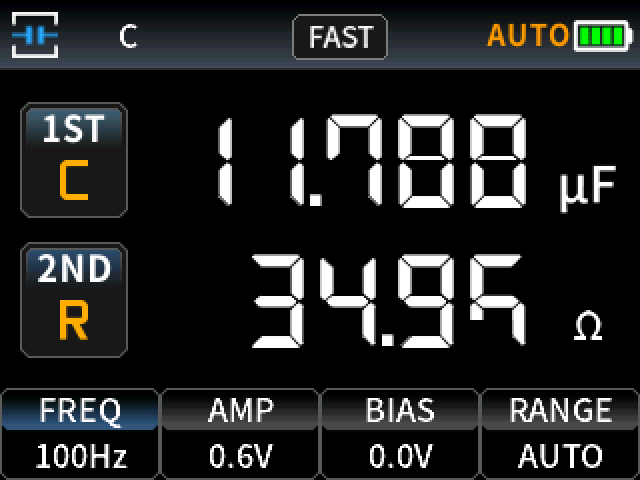
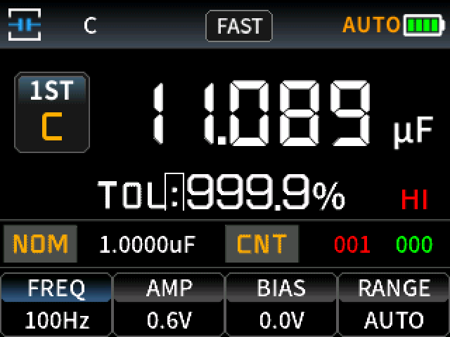
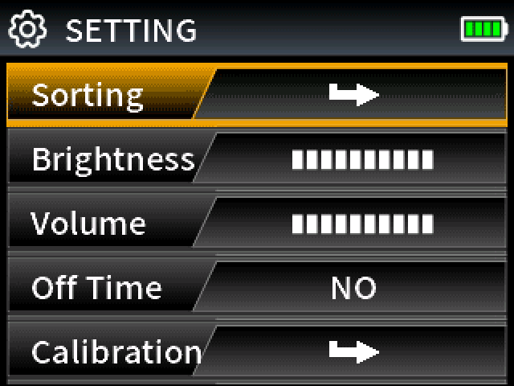

# FNIRSI LC1020E firmware rewrite

Replacement firmware for the **FNIRSI LC1020E** LCR meter, written by hand in **Thumb-2 assembly**:
a new measurement core, calibration and display, a two-part bootloader that an interrupted update
cannot break, and full control over USB.

  
  
  

Screenshots taken over USB from a meter running this firmware.

## What's new compared to the vendor firmware

| | |
|---|---|
| **Measurement** | New core: whole signal periods, DFT with a noise estimate, complex averaging, settle times, saturation detection |
| **60 Hz** | A test frequency next to 100 Hz, 120 Hz, 1 kHz, 10 kHz and 100 kHz |
| **Honest readings** | OL outside the manual's measurement range, amber digits outside its accuracy table, no impossible negative values |
| **AUTO** | R / C / L and series / parallel chosen with hysteresis, so the display does not flip back and forth |
| **Calibration** | New open / short sweep with complex compensation, plus a separate gain calibration area |
| **Compare mode** | HI / IN / LO judged once per part, asymmetric and IEC-letter tolerances, a secondary limit, counters |
| **Settings** | Kept in two copies, so a power cut during a save never loses them or the calibration |
| **Updates** | Copy a `.uf2` file to the meter's USB drive; an interrupted update leaves the meter in update mode |
| **USB control** | Every key, setting and reading, screenshots, backups and updates over USB ([PROTOCOL.md](PROTOCOL.md)) |
| **Everyday use** | English only, Off Time and low-battery power-off, a crystal-fault message instead of silent restarts |

Everything in detail: [FEATURES.md](FEATURES.md).

## Companion app

[**FNIRSI Companion**](https://github.com/zombu4/fnirsi-companion) is a desktop program for Windows,
macOS and Linux that works with this firmware: live readings, compare mode, the meter's settings,
calibration, backups and updates.

## Installing

> [!WARNING]
> The vendor firmware locks the flash. Unlocking it **erases the whole chip**, including the meter's
> calibration. Back it up first, exactly as the guide describes, and read the guide's warnings before
> you start.

The first installation needs an SWD probe. [GUIDE.md](GUIDE.md) walks through it, with the output to
expect at every step:

1. Wire the probe and back up the flash (sections 3 to 6).
2. Remove the read protection and write the backup back (sections 7 to 9).
3. Install the two-part bootloader and this firmware (sections 10 and 11).

After that, updates need no probe and no key press:

    python3 -I tools/lc1020e.py update APP_OWN.uf2 --yes

## Building

You need `arm-none-eabi` binutils, Python 3 and your own copy of the vendor update file
(`LC1020E_V1.1_250702.bin`). The vendor's fonts and pictures are not in this repository;
`make vendor-data` copies them out of your file.

    make -C firmware vendor-data IMAGE=<LC1020E_V1.1_250702.bin>
    make -C firmware check own      # vendor V1.1 rebuilt byte for byte, then our build and its .uf2

The result is `firmware/build/own/APP_OWN.uf2`.

## Testing

The tests run in an emulator of the chip, its USB device and the measurement hardware. They need
[Unicorn](https://www.unicorn-engine.org/):

    python3 -m venv venv && venv/bin/pip install unicorn
    venv/bin/python -I tests/check_never_brick.py --app
    venv/bin/python -I tests/test_chain.py
    venv/bin/python -I tests/test_own_measure.py

What each test covers: [FEATURES.md](FEATURES.md#tests-tests). GitHub Actions builds the dumper and the
starter and runs their tests on every push (the other parts need the vendor files).

## Repository layout

| Folder | Content |
|---|---|
| [`firmware/`](firmware/) | The vendor application ported to assembly (`src/`) and our modules (`own/`) |
| [`bootloader/`](bootloader/) | The vendor bootloader ported to assembly, and the slot bootloader built from it |
| [`starter/`](starter/) | First stage of the two-part bootloader (flash page 0) |
| [`dumper/`](dumper/), [`swd/`](swd/) | Tools for the first backup and installation over SWD |
| [`tools/`](tools/) | Host tools: `lc1020e.py` (USB control), UF2 converter, image builders |
| [`tests/`](tests/) | Emulator tests and static checks |

## License

Non-commercial, see [LICENSE](LICENSE). Not affiliated with FNIRSI.
